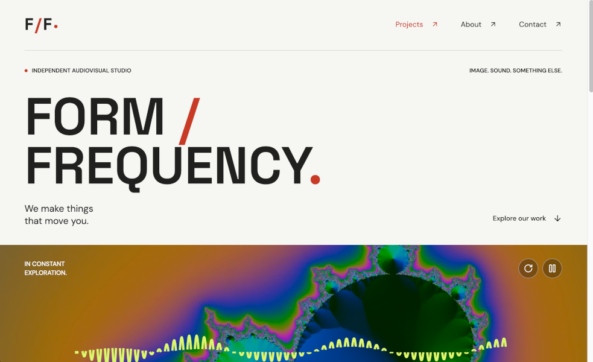

# Studio-site

## AI generated

I wanted to try my hand at a fully AI generated web app. This code is entirely AI generated and I've put it on my Github to demonstrate my prompt engineering, in which at this point I've had about a full year of experience. The site was created in NEXT.js to make use of server side rendering.

## License notes

This repository is publicly visible for reference and demonstration purposes.
No license is granted for use, copying, modification, or distribution of the source code.
All rights reserved.
